# Workflows

Every data workflow in the project as a graph: the Spark ingestion lifecycle, the
three post-ingestion processing stages, the RAG question flow, the launcher chain,
the operational tools, and the persisted state machines. Each diagram is transcribed
from the code; node labels name the actual functions involved.

Function signatures live in the [module map](module_map.md); runtime behavior rules
(limits, locks, recovery) in [architecture.md](architecture.md); the module-level
import graph in [architecture.md](architecture.md#module-interaction-graph).

---

## 1. End-to-end data flow

The four phases run independently against PostgreSQL; only versioned keys
(`CHUNKING_VERSION`, `EMBEDDING_MODEL`/`EMBEDDING_VERSION`) connect them.

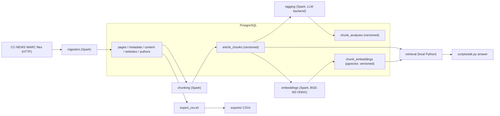

Scheduling order is free: all three processing stages can run in any order and
interleaved; each reads only the rows it depends on (`tagging` and `embeddings`
both read `article_chunks` eligible/materialized rows).

---

## 2. Ingestion run lifecycle (`ingestion.pipeline`)

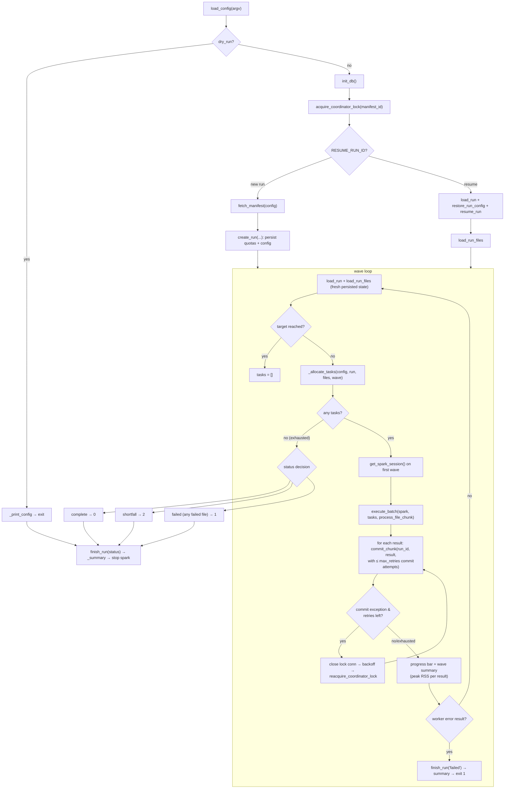

Worker side (inside `process_file_chunk` → `_process_file_once`, executor):

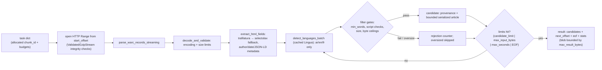

### Commit transaction (driver, `db.db_handler.commit_chunk`)

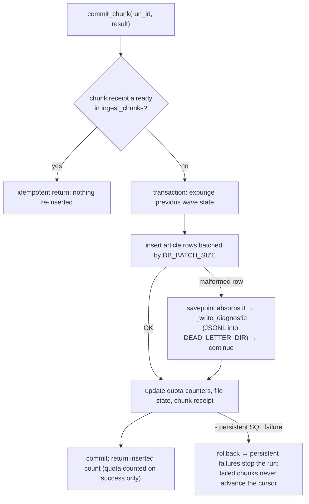

---

## 3. Bounding wave engine (`jobs.batching.run_waves` — shared by all processing stages)

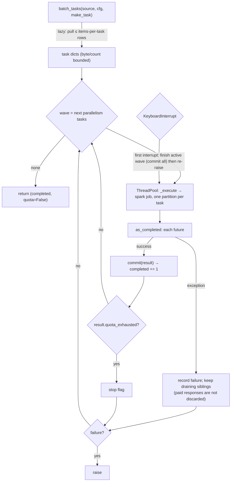

---

## 4. Chunking workflow (`scripts/chunk.py` → `chunking.pipeline.run`)

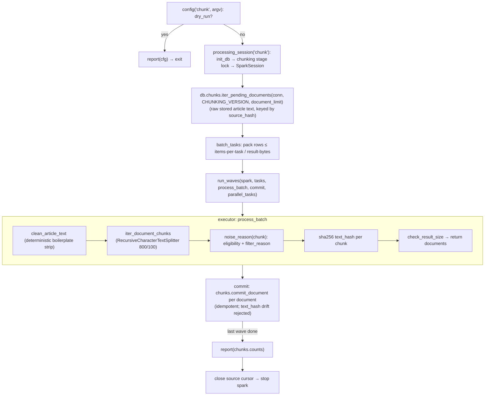

Output rows: `article_chunks` gains versioned `(chunk_index, chunk_text, text_hash,
eligible, filter_reason)` rows, and `chunk_materializations` records the
materialization receipt that makes re-runs idempotent and detects `source_hash`
text drift.

---

## 5. Tagging workflow (`scripts/tag.py` → `tagging.pipeline.run`)

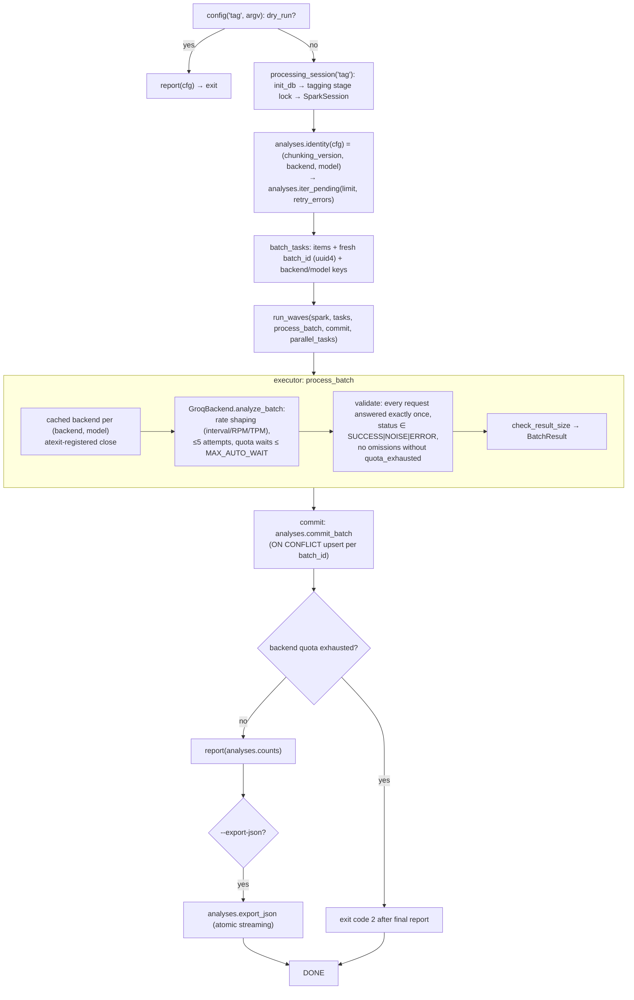

Status model per chunk: `SUCCESS` (summarized), `NOISE` (ruled not-article via
`is_noise_summary`), `ERROR` (attempt_count recorded; re-picked by
`iter_pending(..., retry_errors=True)` on the next run).

---

## 6. Embeddings workflow (`scripts/embed.py` → `embeddings.pipeline.run`)

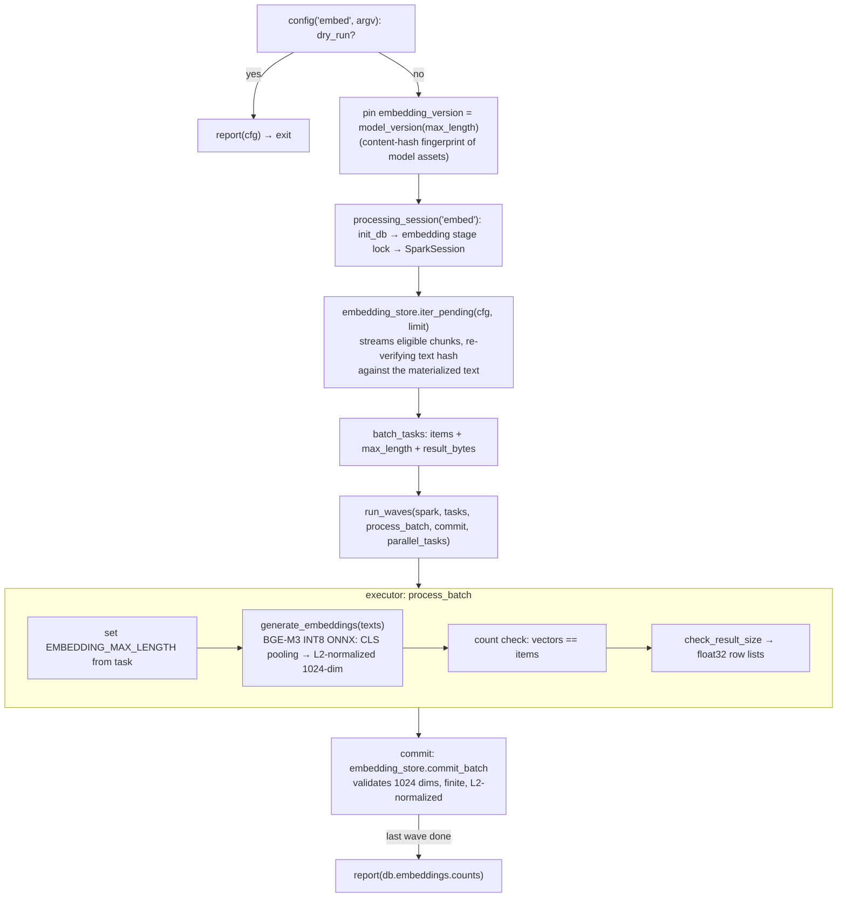

---

## 7. RAG question flow (`scripts/ask.py` → `retrieval`)

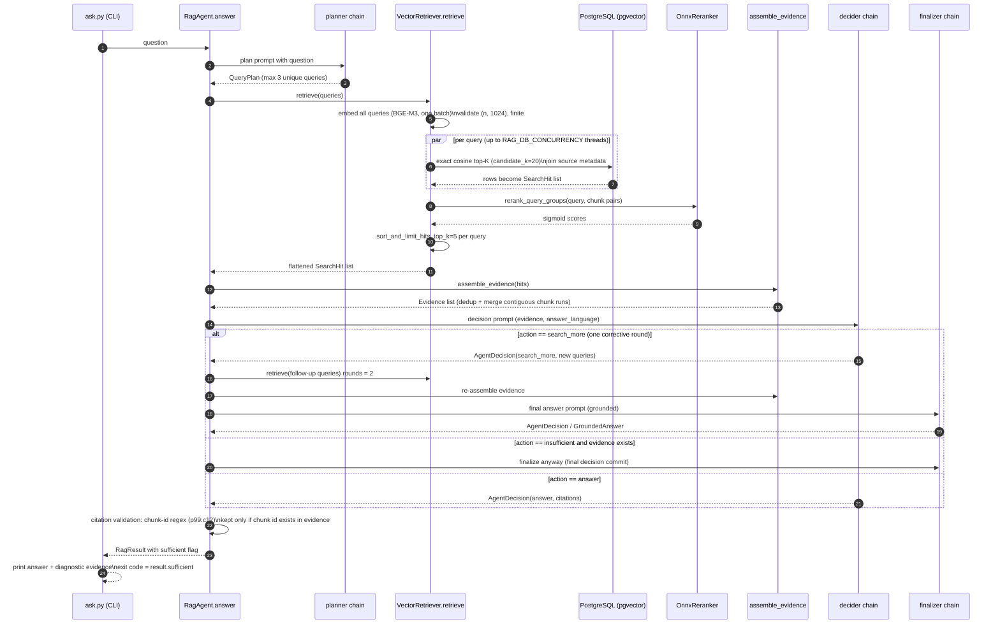

Concurrency notes: `retrieve` runs on a dedicated coordinator thread (deterministic
shutdown on Python 3.13); search queries fan out with
`max_concurrent_searches`; missing/corrupt reranker model files abort — there is
no silent cosine-only fallback.

---

## 8. Launcher / deployment chain

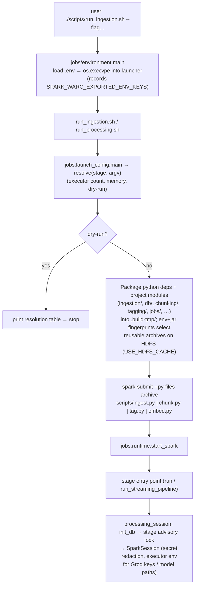

Applies to all four launchers: `run_ingestion.sh` uses ingestion's own scheduling;
`run_chunking.sh` / `run_tagging.sh` / `run_embeddings.sh` share
`run_processing.sh` and `jobs.batching.run_waves`.

---

## 9. Operational tools

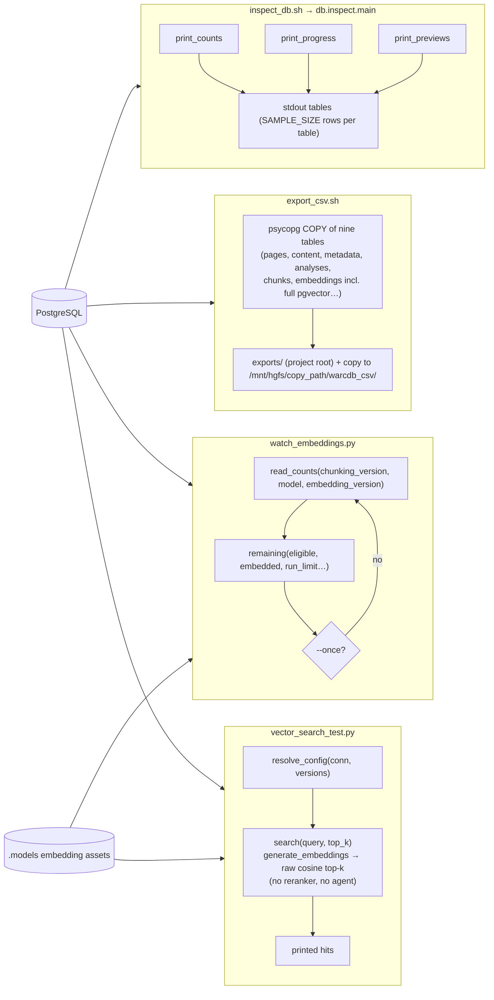

---

## 10. Persisted state machines

### Ingestion files (`ingest_files` / `ingest_run_files`)

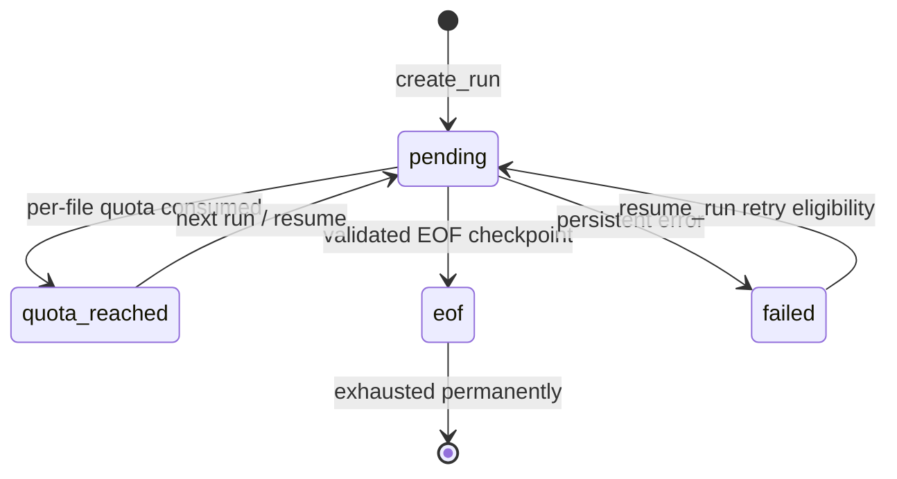

### Ingestion runs (`ingest_runs`)

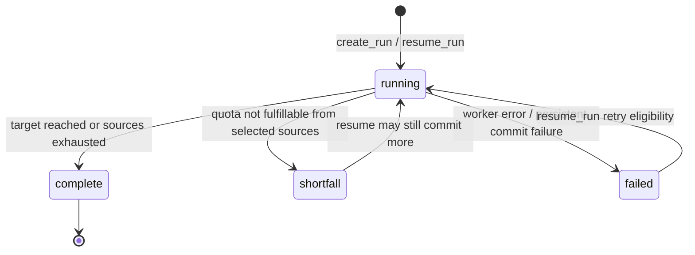

### Tagging chunk statuses (`chunk_analyses`)

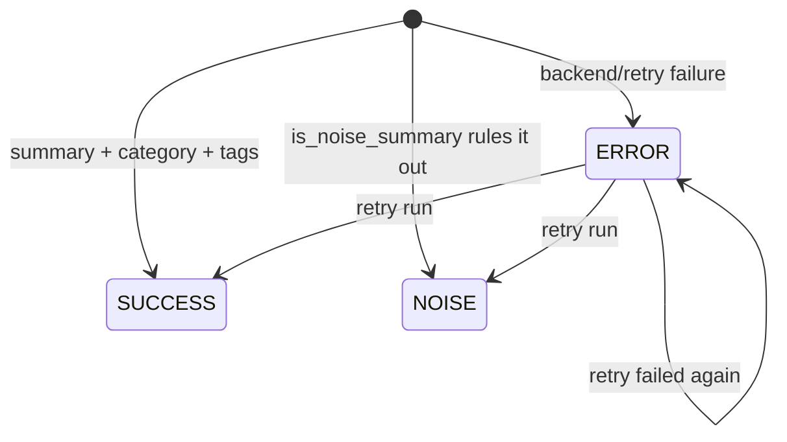

### Chunk versioning (`article_chunks` ↔ `chunk_materializations`)

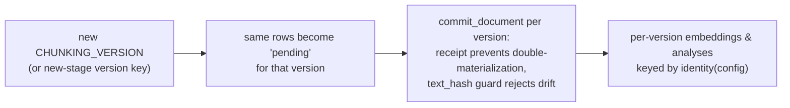

---

## Diagram index

| § | Workflow | Entry point |
|---|---|---|
| 1 | End-to-end phases | — |
| 2 | Ingestion lifecycle, worker, commit txn | `scripts/run_ingestion.sh` |
| 3 | Shared wave engine | `jobs.batching.run_waves` |
| 4 | Chunking | `scripts/run_chunking.sh` |
| 5 | Tagging | `scripts/run_tagging.sh` |
| 6 | Embeddings | `scripts/run_embeddings.sh` |
| 7 | RAG question flow | `scripts/ask.py` |
| 8 | Launcher / deployment | shell launchers |
| 9 | Operational tools | `inspect_db.sh`, `export_csv.sh`, `watch_embeddings.py`, `vector_search_test.py` |
| 10 | State machines | persisted tables |
